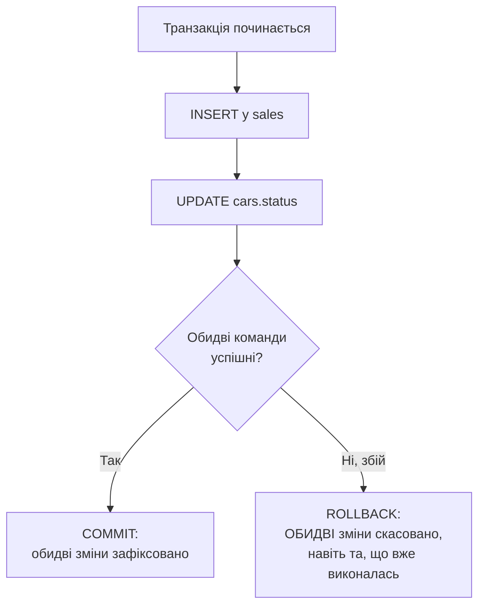

# Лекція 12. Принципи ACID і необхідність транзакцій

*Практика 13 і наступні дедалі частіше вимагатимуть не одну команду,
а КІЛЬКА пов'язаних команд, які мають відбутися разом — наприклад,
"продати автомобіль" означає одразу і додати рядок у `sales`, і
позначити авто як `'продано'` у `cars`. Що станеться, якщо перша
команда виконалась, а друга — ні (збій програми, втрата з'єднання,
помилка)? Ця лекція пояснює, чому таку "пару" операцій потрібно
розглядати як єдине неподільне ціле, і що станеться з базою, якщо
цього не зробити.*

## 1. Мотивуюча проблема: розірвана пара операцій

Уявімо продаж автомобіля без жодного спеціального механізму — просто
дві послідовні команди:

```sql
INSERT INTO sales (car_id, client_id, sale_date, sale_price)
VALUES (5, 3, '2025-06-10', 980000);

UPDATE cars SET status = 'продано' WHERE id = 5;
```

Якщо перша команда виконалась, а друга не встигла (програма впала,
зникло живлення, помилка мережі до бази на сервері) — база залишається
в **неузгодженому стані**: запис про продаж уже існує, а сам автомобіль
досі позначений як `'в наявності'`. Другий продавець теоретично може
продати той самий автомобіль вдруге. Проблема не в самому SQL —
обидві команди написані правильно, — а в тому, що між ними немає
жодної гарантії "або обидві, або жодна".

## 2. Транзакція — неподільна група операцій

**Транзакція** — це група SQL-команд, яка виконується як одне
неподільне ціле: або ВСІ команди групи застосовуються до бази, або
(у разі будь-якого збою чи свідомої відмови) — **жодна**. Проміжного
стану "виконалась лише половина групи" в базі після завершення
транзакції не залишається ніколи.



Синтаксис (`BEGIN`, `COMMIT`, `ROLLBACK`) — тема наступної лекції; тут
важливий сам принцип: рішення "зафіксувати" чи "скасувати" приймається
для ВСІЄЇ групи одразу, а не для кожної команди окремо.

## 3. ACID — чотири властивості надійної транзакції

**ACID** — акроним чотирьох властивостей, які має гарантувати кожна
транзакція в надійній СУБД (включно з SQLite):

- **Atomicity (атомарність)** — "все або нічого": з прикладу вище,
  `INSERT` у `sales` і `UPDATE` в `cars` або застосовуються ОБИДВА, або
  жоден. Це саме та властивість, що вирішує мотивуючу проблему з
  розділу 1.
- **Consistency (узгодженість)** — транзакція переводить базу з одного
  коректного стану в інший коректний стан: усі обмеження цілісності
  (`NOT NULL`, `UNIQUE`, `CHECK`, зовнішні ключі — Лекція 6) мають
  виконуватись і до, і після транзакції. Транзакція, що порушила б
  обмеження, не застосовується взагалі.
- **Isolation (ізольованість)** — якщо з базою одночасно працює кілька
  користувачів (чи процесів), одна незавершена транзакція не повинна
  бути видимою для іншої, доки не завершиться. SQLite гарантує це на
  рівні файлу бази через систему блокувань (механіку й практичний
  наслідок "database is locked" розглядає наступна лекція); у СУБД для
  багатьох користувачів, як PostgreSQL, це складніший механізм.
- **Durability (стійкість)** — якщо транзакція завершилась успішно
  (`COMMIT`), її результат гарантовано зберігається навіть у разі
  збою живлення чи аварійного завершення програми одразу після цього —
  дані вже записані на диск, а не лише в пам'яті.

## 4. Без явної транзакції: кожна команда — сама собі транзакція

```sql
INSERT INTO sales (car_id, client_id, sale_date, sale_price)
VALUES (5, 3, '2025-06-10', 980000);
-- у цьому місці зміна ВЖЕ зафіксована в базі, окремо від наступної команди

UPDATE cars SET status = 'продано' WHERE id = 5;
-- це друга, повністю НЕЗАЛЕЖНА транзакція
```

Це і є причина проблеми з розділу 1: без явного `BEGIN`/`COMMIT`
кожна окрема команда SQL виконується як **своя власна, неявна
транзакція** — застосовується одразу, незалежно від сусідніх команд.
Щоб дві (чи більше) команди утворили одну спільну транзакцію, потрібно
явно позначити її межі — синтаксис `BEGIN`/`COMMIT`/`ROLLBACK`
розглядає Лекція 13.

## 5. Що ламається без кожної з властивостей

Розглянемо, що станеться з базою, якщо прибрати кожну з властивостей по черзі: так видно, від якої поломки захищає кожна літера.

**Без атомарності** база опиняється в проміжному стані. Нехай у таблиці `accounts` є два рахунки, а перевід грошей складається з двох команд: списати суму з одного рахунку й зарахувати на інший. Якщо збій стався між ними, гроші або зникли, або з'явилися з нізвідки.

**Без узгодженості** в базі з'являються дані, що суперечать правилам предметної області: від'ємний баланс, продаж неіснуючого автомобіля, замовлення без клієнта. Правила задаються обмеженнями (`CHECK`, `NOT NULL`, `FOREIGN KEY`), а транзакція гарантує, що жодне з них не буде порушене після її завершення.

**Без ізольованості** один користувач бачить недороблені зміни іншого. Нехай продавець А почав оформлювати продаж автомобіля й змінив його статус на `'продано'`, але операцію ще не завершив:

| Крок | Продавець А | Продавець Б |
|---|---|---|
| 1 | змінює статус авто на `'продано'`, транзакція ще не завершена | |
| 2 | | читає статус `'продано'` і відмовляє своєму клієнтові |
| 3 | клієнт не оплатив, тож А скасовує транзакцію (`ROLLBACK`) | |
| 4 | авто знову `'в наявності'` | продаж втрачено |

Продавець Б ухвалив рішення на даних, яких насправді ніколи не існувало. Ізольованість гарантує, що Б побачить зміну А лише після її фіксації.

**Без стійкості** підтвердження від бази нічого не варте: користувач бачить повідомлення «збережено», а після відключення живлення запису немає, бо він так і не потрапив із пам'яті на диск.

## 6. Приклад: переказ коштів між рахунками

Створимо таблицю, у якій правило «баланс не може бути від'ємним» оголошене прямо в структурі:

```sql
CREATE TABLE accounts (
    id      INTEGER PRIMARY KEY,
    owner   TEXT,
    balance INTEGER CHECK (balance >= 0)
);

INSERT INTO accounts (owner, balance) VALUES ('Олена', 300), ('Тарас', 100);
```

Олена хоче переказати Тарасу 500, хоча на її рахунку лише 300. Така операція мусить бути відхилена цілком. Виконаємо обидві команди окремо, без явної транзакції:

```sql
UPDATE accounts SET balance = balance + 500 WHERE owner = 'Тарас';
UPDATE accounts SET balance = balance - 500 WHERE owner = 'Олена';
```

```text
Runtime error: CHECK constraint failed: balance>=0
```

Друга команда справді відхилена обмеженням `CHECK`, але перша вже виконана й зафіксована сама собою (розділ 4). Порядок команд тут навмисний: якби першою йшло списання, помилка зупинила б операцію одразу, і проблеми не було б видно:

```sql
SELECT owner, balance FROM accounts;
```

```text
owner  balance
Олена  300
Тарас  600
```

У системі було 400 одиниць, тепер стало 900: Тарас отримав 500, яких Олена не відправляла. Обмеження `CHECK` спрацювало правильно, але врятувати цілісність усієї операції воно не могло, бо кожна команда була окремою транзакцією. Якби обидві команди входили в одну транзакцію, програма, помітивши помилку, виконала б `ROLLBACK` (Лекція 13), і скасувалась би також уже виконана перша команда: баланси лишились би 300 і 100. Сама помилка транзакцію не скасовує, це рішення приймає програма: якби після помилки виконали `COMMIT`, перша зміна все одно збереглась би.

Цей приклад показує, що властивості ACID працюють разом. Узгодженість визначає, що вважати помилкою (від'ємний баланс), атомарність дає змогу скасувати через `ROLLBACK` усю групу, а не лише команду, що впала, а стійкість гарантує, що результат успішно зафіксованої групи не зникне.

## 7. Чого ACID не гарантує

Є кілька поширених помилкових уявлень.

Транзакція не перевіряє **змістової правильності** даних. Якщо в базі немає обмеження `CHECK (balance >= 0)`, то нічого не завадить зробити баланс від'ємним, і транзакція це спокійно зафіксує. Узгодженість у значенні ACID означає лише дотримання тих правил, які ви самі оголосили в схемі.

Транзакція не робить запит швидшим і не замінює індекси: це механізм надійності, а не продуктивності. Більше того, довга транзакція може заважати іншим користувачам, бо тримає блокування (Лекція 13).

Нарешті, ACID гарантує поведінку **в межах однієї бази**. Якщо програма пише в базу, а потім відправляє лист, відкотити лист транзакція не зможе: зовнішні дії лежать поза її контролем.

## 8. Запитання для самоперевірки

**Користувач натиснув «Оплатити», програма вставила рядок у `orders`, а на другій команді втратила з'єднання. У якому стані опиниться база без явної транзакції?**

У неузгодженому: замовлення існує, але супутня зміна (наприклад, зменшення залишку на складі) не виконана. Порушена атомарність, бо дві пов'язані дії не були об'єднані в одну транзакцію.

**Яка властивість ACID гарантує, що після `COMMIT` і раптового вимкнення комп'ютера дані збережуться?**

Стійкість (Durability): успішно зафіксований результат уже записаний на диск, а не лише в оперативну пам'ять.

**Яка з властивостей відповідає за те, що обмеження `NOT NULL`, `UNIQUE` і `FOREIGN KEY` виконуються після транзакції?**

Узгодженість (Consistency): після завершення транзакції в базі не лишається порушень оголошених обмежень. Команда, що порушує обмеження, відхиляється, а щоб скасувати всю групу, потрібен `ROLLBACK`.

**Двоє користувачів одночасно змінюють одну таблицю. Чому один не повинен бачити незавершені зміни іншого?**

Це вимога ізольованості. Незавершену транзакцію ще можуть скасувати, тож рішення, ухвалені на основі її проміжних даних, виявилися б помилковими.

**Чому наявності обмеження `CHECK` недостатньо, щоб переказ коштів був безпечним?**

Обмеження відхиляє лише ту команду, що його порушує. Якщо до цього вже виконалась інша команда групи, її результат лишається. Щоб скасувалась уся група, її об'єднують в одну транзакцію й після помилки виконують `ROLLBACK`.

## Підсумок

- Транзакція — неподільна група SQL-команд: результат застосовується
  до бази або весь одразу, або не застосовується взагалі.
- **ACID**: Atomicity (все або нічого), Consistency (обмеження
  цілісності виконуються завжди), Isolation (незавершена транзакція не
  видима іншим), Durability (зафіксований результат переживає збій).
- Без явного `BEGIN`/`COMMIT` кожна окрема команда — власна неявна
  транзакція, і саме тому пов'язана пара команд без явних меж
  транзакції може "розірватися" при збої між ними.
- Кожна властивість ACID захищає від власної поломки: без атомарності пара операцій розривається, без ізольованості одночасні користувачі бачать недоробки одне одного.
- Транзакція гарантує дотримання лише тих правил, які оголошено в схемі (`CHECK`, `NOT NULL`, ключі), а не змістову правильність даних.

**Наступна лекція:** [Лекція 13. Транзакції у SQLite: BEGIN, COMMIT, ROLLBACK](13-transactions.md)

## Рекомендована література

Павловський В. І., Петрашенко А. В. *Бази даних та засоби управління.* — Київ: КПІ ім. Ігоря Сікорського, 2024 ([відкритий доступ](https://ela.kpi.ua/bitstreams/9f26675d-c42f-485e-aab5-13e6e014b560/download)). Розділ про транзакції та багатокористувацький паралельний доступ — властивості транзакцій, рівні ізоляції.

Харів Н. О. *Бази даних та інформаційні системи.* — Рівне: НУВГП (Національний університет водного господарства та природокористування), 2018 ([відкритий доступ](https://ep3.nuwm.edu.ua/9129/3/%D0%A5%D0%B0%D1%80%D1%96%D0%B2%20%D0%9D.%D0%9E.pdf)). Розділ «Транзакції» — властивості ACID у контексті реалізації транзакцій у Firebird/IBExpert.
